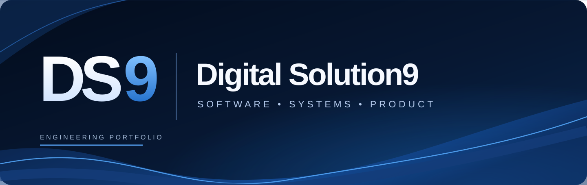
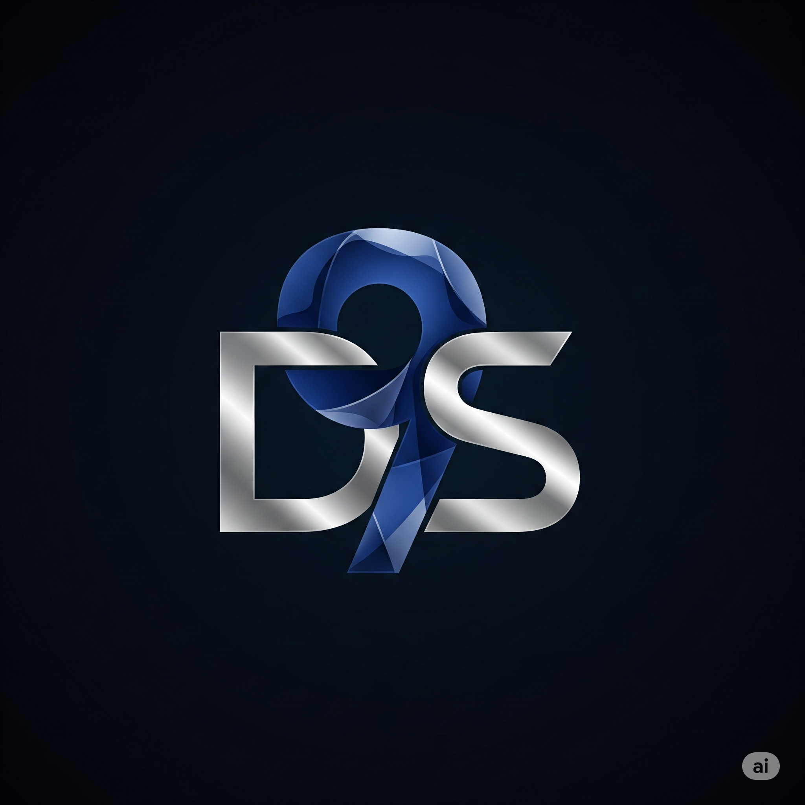
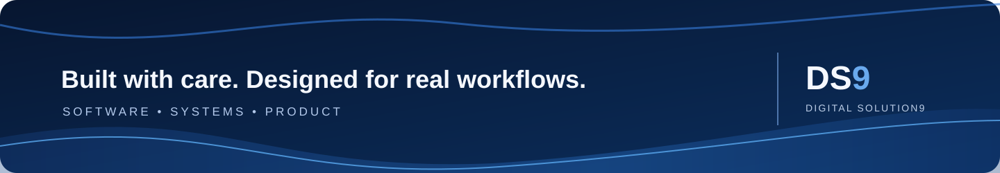

<!-- DS9 · Digital Solution9 / official GitHub profile -->

 

**Full-stack engineering portfolio** &nbsp;·&nbsp; Business applications &nbsp;·&nbsp; Product prototypes

<a href="#featured-projects"><strong>Featured work</strong></a> &nbsp;&nbsp;|&nbsp;&nbsp; <a href="#project-directory"><strong>All projects</strong></a> &nbsp;&nbsp;|&nbsp;&nbsp; <a href="#technology"><strong>Technology</strong></a> &nbsp;&nbsp;|&nbsp;&nbsp; <a href="https://github.com/shakaleita?tab=repositories"><strong>GitHub repositories</strong></a>

---

<table>
<tr>
<td width="24%" align="center" valign="middle">

</td>
<td width="76%" valign="middle">

### Software that makes sense.

At **Digital Solution9**, I explore the space between a good idea and working software—turning real operational problems into clear interfaces, reliable APIs and focused applications.

The work spans commerce, scheduling, sales, business tools and knowledge systems. I aim for thoughtful design, understandable architecture and honest engineering.

</td>
</tr>
</table>

> **21 public projects. Different problems, one approach:** build the useful part first, test what matters, and make each iteration stronger.

These are portfolio prototypes, local demonstrations and engineering case studies. They should not be treated as publicly deployed or production-hardened services unless a repository states otherwise.

## Featured projects

Six projects that reflect the kind of systems I enjoy designing, building, testing and improving.

<table>
<tr>
<td width="50%" valign="top">
   
  <strong><a href="https://github.com/shakaleita/teamforge-saas">TeamForge</a></strong> 
  Workspace task boards, Kanban flows and activity history. 
  React · FastAPI · SQLite
</td>
<td width="50%" valign="top">
   
  <strong><a href="https://github.com/shakaleita/Mercato-E-Commerce-Platform">Mercato</a></strong> 
  Inventory management and transaction-safe checkout. 
  React · FastAPI · SQLite
</td>
</tr>
<tr>
<td width="50%" valign="top">
   
  <strong><a href="https://github.com/shakaleita/ClinicFlow-Medical-Booking-System">ClinicFlow</a></strong> 
  Clinic scheduling with availability and rescheduling rules. 
  React · FastAPI · SQLite
</td>
<td width="50%" valign="top">
   
  <strong><a href="https://github.com/shakaleita/Pipeline-Sales-CRM">Pipeline</a></strong> 
  Deal stages, sales activity and weighted pipeline forecasts. 
  React · FastAPI · SQLite
</td>
</tr>
<tr>
<td width="50%" valign="top">
   
  <strong><a href="https://github.com/shakaleita/UptimePilot-API-Monitoring">UptimePilot</a></strong> 
  HTTP checks, uptime history and reliability reporting. 
  React · FastAPI · SQLite
</td>
<td width="50%" valign="top">
   
  <strong><a href="https://github.com/shakaleita/agenthub-api">AgentHub API</a></strong> 
  Deterministic rules engine with execution audit history. 
  Python · FastAPI · SQLite
</td>
</tr>
</table>

## Project directory

The full public portfolio. Each card links to its source, documentation and setup instructions.

### 01 — Business systems & operations

Practical tools for businesses, teams and everyday operations.

<table>
<tr>
<td width="50%" valign="top">
   
  <strong><a href="https://github.com/shakaleita/nexacrm">NexaCRM</a></strong> 
  Companies, contacts, deals and scheduled follow-ups. 
  Node.js · Express · SQLite
</td>
<td width="50%" valign="top">
   
  <strong><a href="https://github.com/shakaleita/bizflow-erp">BizFlow ERP</a></strong> 
  Suppliers, purchase orders, stock receipts and inventory. 
  Python · Flask · SQLite
</td>
</tr>
<tr>
<td width="50%" valign="top">
   
  <strong><a href="https://github.com/shakaleita/supportdesk-saas">SupportDesk</a></strong> 
  Support tickets, assignment, queues and internal notes. 
  Node.js · Express · SQLite
</td>
<td width="50%" valign="top">
   
  <strong><a href="https://github.com/shakaleita/laravel-inventory">Laravel Inventory</a></strong> 
  Stock movements, SKU constraints and reorder alerts. 
  PHP · Laravel · MySQL
</td>
</tr>
<tr>
<td width="50%" valign="top">
   
  <strong><a href="https://github.com/shakaleita/recruitflow">RecruitFlow</a></strong> 
  Job openings, applicants and hiring-stage workflows. 
  Node.js · Express · SQLite
</td>
<td width="50%" valign="top">
   
  <strong><a href="https://github.com/shakaleita/invoicepilot">InvoicePilot</a></strong> 
  Customer invoices, tax calculations and payment states. 
  Python · FastAPI · SQLite
</td>
</tr>
<tr>
<td width="50%" valign="top">
   
  <strong><a href="https://github.com/shakaleita/teamtask">TeamTask</a></strong> 
  Team task board with assignments and priorities. 
  Node.js · Express · SQLite
</td>
<td width="50%" valign="top">
   
  <strong><a href="https://github.com/shakaleita/shopadmin">ShopAdmin</a></strong> 
  Product catalogue, orders and fulfilment status. 
  PHP · Laravel · MySQL
</td>
</tr>
</table>

### 02 — Content, communication & tools

Products built around better access to information and smoother digital experiences.

<table>
<tr>
<td width="50%" valign="top">
   
  <strong><a href="https://github.com/shakaleita/KnowBase-Document-Search">KnowBase</a></strong> 
  Document search, revision snapshots and knowledge retrieval. 
  React · FastAPI · SQLite
</td>
<td width="50%" valign="top">
   
  <strong><a href="https://github.com/shakaleita/CourseCraft-Learning">CourseCraft</a></strong> 
  Courses, learner progress and completion reports. 
  React · FastAPI · SQLite
</td>
</tr>
<tr>
<td width="50%" valign="top">
   
  <strong><a href="https://github.com/shakaleita/PulseChat-Real-Time-Messaging">PulseChat</a></strong> 
  Room-based messaging and checked WebSocket workflows. 
  React · FastAPI · WebSockets
</td>
<td width="50%" valign="top">
   
  <strong><a href="https://github.com/shakaleita/InsightLab-Business-Analytics">InsightLab</a></strong> 
  CSV sales analytics, filters and trend reporting. 
  React · FastAPI · SQLite
</td>
</tr>
<tr>
<td width="50%" valign="top">
   
  <strong><a href="https://github.com/shakaleita/PageCraft-Headless-CMS">PageCraft</a></strong> 
  Versioned content with publishing and revision comparisons. 
  React · FastAPI · SQLite
</td>
<td width="50%" valign="top">
   
  <strong><a href="https://github.com/shakaleita/helpbot-widget">HelpBot Widget</a></strong> 
  Embeddable FAQ search and lightweight self-service help. 
  Python · Flask · JavaScript
</td>
</tr>
</table>

### 03 — Engineering archive

<table>
<tr>
<td width="50%" valign="top">
   
  <strong><a href="https://github.com/shakaleita/Beautyfort-API">BeautyFort API</a></strong> 
  Legacy WooCommerce/SOAP integration security and migration review. 
  Legacy integration · Disabled
</td>
<td width="50%"></td>
</tr>
</table>

<strong>About BeautyFort:</strong> historical integration material includes credited third-party work. The legacy stock integration is disabled pending a security rewrite; this repository is shown as an engineering review, not as an original finished product.

---

## Technology

I use different tools depending on the problem. These are some of the technologies used across the portfolio.

<table>
<tr><td><strong>Frontend & interaction</strong></td><td>React · Vite · JavaScript · HTML · CSS</td></tr>
<tr><td><strong>APIs & backend</strong></td><td>Python · FastAPI · Flask · Node.js · Express · PHP · Laravel</td></tr>
<tr><td><strong>Data & workflows</strong></td><td>SQLite · MySQL · REST APIs · transactional operations</td></tr>
<tr><td><strong>Delivery & quality</strong></td><td>pytest · integration testing · Docker · GitHub Actions</td></tr>
</table>

### The way I build

**Useful first.** Design for the workflow, not for a screenshot.

**Deliberate by default.** Clear names, simple data models, thoughtful error handling and tests.

**Room to evolve.** A focused MVP should show what works, what doesn't, and what comes next.

 

<a href="https://github.com/shakaleita?tab=repositories"><strong>Explore all public repositories</strong></a> &nbsp; · &nbsp; <a href="#featured-projects">Back to featured work</a>

  

 

Digital Solution9 © 2026 · A growing engineering portfolio

  

Also building the PrimeEcho brand 

