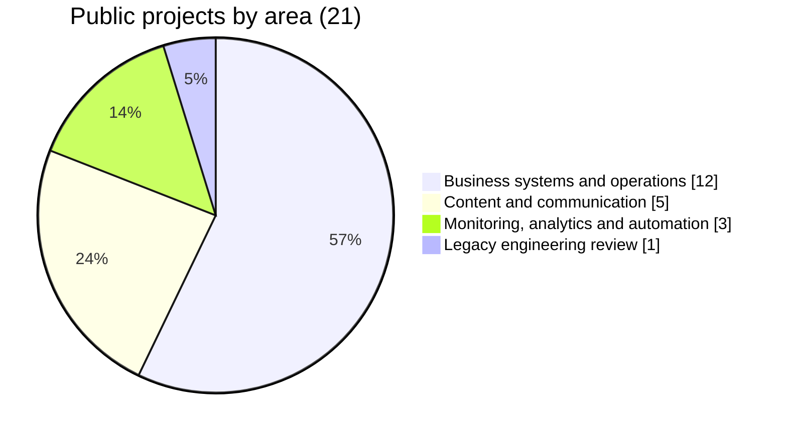
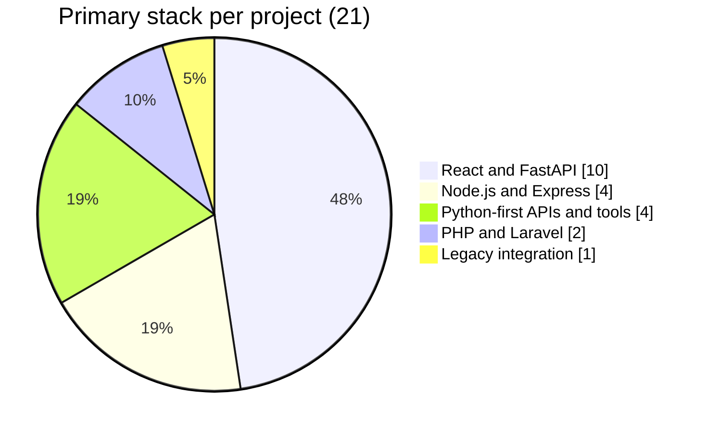
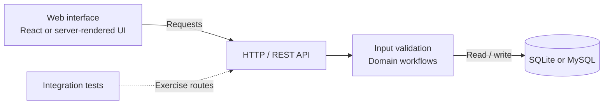
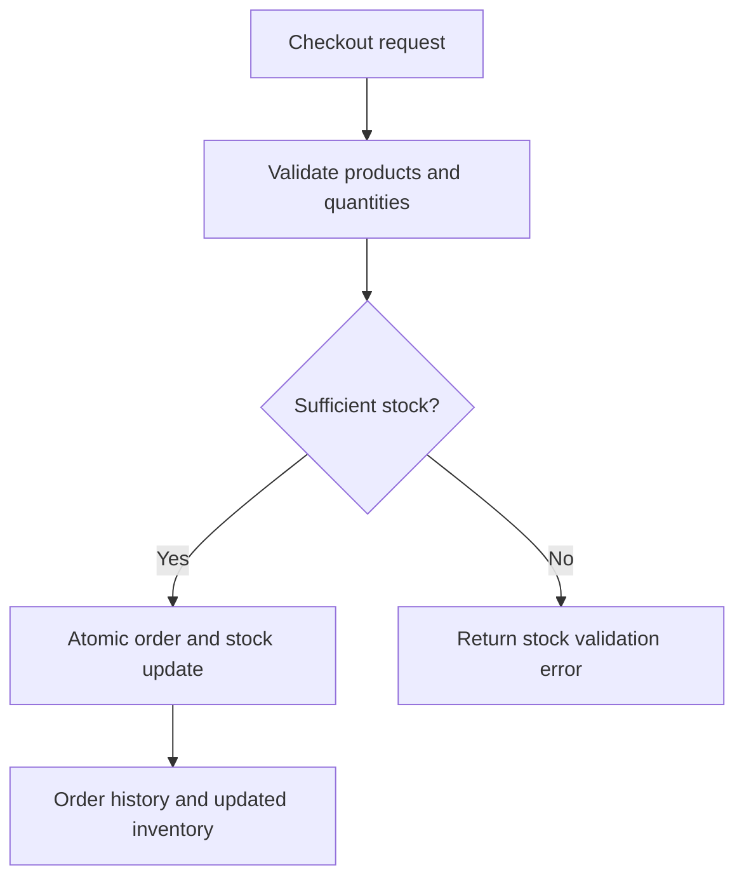
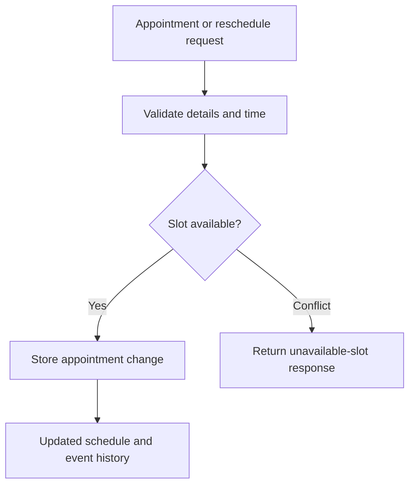

<!-- DS9 | Digital Solution9 | GitHub portfolio -->

 

<strong>Engineering portfolio · Full-stack applications · APIs · Product prototypes</strong>

  

<a href="#featured-projects"><strong>Featured projects</strong></a> &nbsp;·&nbsp;
<a href="#portfolio-overview"><strong>Portfolio overview</strong></a> &nbsp;·&nbsp;
<a href="#project-directory"><strong>Project directory</strong></a> &nbsp;·&nbsp;
<a href="#architecture--workflows"><strong>Architecture &amp; workflows</strong></a> &nbsp;·&nbsp;
<a href="#technology"><strong>Technology</strong></a>

---

<table>
<tr>
<td width="22%" align="center" valign="middle">

</td>
<td width="78%" valign="middle">
<h3>Software built around real workflows.</h3>

A portfolio of practical software projects spanning operational systems, web applications, automation, content management and analytics. The emphasis is on useful features, clear architecture, maintainable code and thoughtful iteration.

Explore working prototypes, implementation details, API documentation and engineering decisions in the linked repositories.

</td>
</tr>
</table>

<table>
<tr>
<td width="33%" align="center"><strong>21</strong> PUBLIC CODE PROJECTS</td>
<td width="34%" align="center"><strong>4</strong> PORTFOLIO AREAS</td>
<td width="33%" align="center"><strong>6</strong> FEATURED BUILDS</td>
</tr>
</table>

Portfolio scope: locally runnable MVPs, technical demonstrations and case studies. These are not presented as production-ready, audited or publicly deployed applications.

## Featured projects

A selection of six working demonstrations spanning collaboration, commerce, scheduling, sales, monitoring and automation.

<table>
<tr>
<td width="50%" valign="top">
   
  <strong><a href="https://github.com/shakaleita/teamforge-saas">TeamForge</a></strong> 
  Workspace task boards, Kanban flows and activity history. 
  React · FastAPI · SQLite
</td>
<td width="50%" valign="top">
   
  <strong><a href="https://github.com/shakaleita/Mercato-E-Commerce-Platform">Mercato</a></strong> 
  Inventory management and transaction-safe checkout. 
  React · FastAPI · SQLite
</td>
</tr>
<tr>
<td width="50%" valign="top">
   
  <strong><a href="https://github.com/shakaleita/ClinicFlow-Medical-Booking-System">ClinicFlow</a></strong> 
  Clinic scheduling with availability and rescheduling rules. 
  React · FastAPI · SQLite
</td>
<td width="50%" valign="top">
   
  <strong><a href="https://github.com/shakaleita/Pipeline-Sales-CRM">Pipeline</a></strong> 
  Deal stages, sales activity and weighted pipeline forecasts. 
  React · FastAPI · SQLite
</td>
</tr>
<tr>
<td width="50%" valign="top">
   
  <strong><a href="https://github.com/shakaleita/UptimePilot-API-Monitoring">UptimePilot</a></strong> 
  HTTP checks, uptime history and reliability reporting. 
  React · FastAPI · SQLite
</td>
<td width="50%" valign="top">
   
  <strong><a href="https://github.com/shakaleita/agenthub-api">AgentHub API</a></strong> 
  Deterministic rules engine with execution audit history. 
  Python · FastAPI · SQLite
</td>
</tr>
</table>

## Portfolio overview

The following charts summarise the **21 public code repositories**, grouped by their primary purpose and documented application stack. These counts describe the portfolio; they are not traffic, revenue, user or performance metrics.

### Projects by area

### Primary technology stacks

Each repository is counted once in each chart. The classifications are based on the documented public projects and do not imply production readiness.

## Project directory

The remaining 15 public code repositories are grouped here. Together with the six featured projects, the portfolio covers all 21 public projects.

### 01 — Business systems & operations

Software for day-to-day operations, administrative work and business workflows.

<table>
<tr>
<td width="50%" valign="top">
   
  <strong><a href="https://github.com/shakaleita/nexacrm">NexaCRM</a></strong> 
  Companies, contacts, deals and scheduled follow-ups. 
  Node.js · Express · SQLite
</td>
<td width="50%" valign="top">
   
  <strong><a href="https://github.com/shakaleita/bizflow-erp">BizFlow ERP</a></strong> 
  Suppliers, purchase orders, stock receipts and inventory. 
  Python · Flask · SQLite
</td>
</tr>
<tr>
<td width="50%" valign="top">
   
  <strong><a href="https://github.com/shakaleita/supportdesk-saas">SupportDesk</a></strong> 
  Support tickets, assignment, queues and internal notes. 
  Node.js · Express · SQLite
</td>
<td width="50%" valign="top">
   
  <strong><a href="https://github.com/shakaleita/laravel-inventory">Laravel Inventory</a></strong> 
  Stock movements, SKU constraints and reorder alerts. 
  PHP · Laravel · MySQL
</td>
</tr>
<tr>
<td width="50%" valign="top">
   
  <strong><a href="https://github.com/shakaleita/recruitflow">RecruitFlow</a></strong> 
  Job openings, applicants and hiring-stage workflows. 
  Node.js · Express · SQLite
</td>
<td width="50%" valign="top">
   
  <strong><a href="https://github.com/shakaleita/invoicepilot">InvoicePilot</a></strong> 
  Customer invoices, tax calculations and payment states. 
  Python · FastAPI · SQLite
</td>
</tr>
<tr>
<td width="50%" valign="top">
   
  <strong><a href="https://github.com/shakaleita/teamtask">TeamTask</a></strong> 
  Team task board with assignments and priorities. 
  Node.js · Express · SQLite
</td>
<td width="50%" valign="top">
   
  <strong><a href="https://github.com/shakaleita/shopadmin">ShopAdmin</a></strong> 
  Product catalogue, orders and fulfilment status. 
  PHP · Laravel · MySQL
</td>
</tr>
</table>

### 02 — Content, communication & tools

Products built around better access to information and smoother digital experiences.

<table>
<tr>
<td width="50%" valign="top">
   
  <strong><a href="https://github.com/shakaleita/KnowBase-Document-Search">KnowBase</a></strong> 
  Document search, revision snapshots and knowledge retrieval. 
  React · FastAPI · SQLite
</td>
<td width="50%" valign="top">
   
  <strong><a href="https://github.com/shakaleita/CourseCraft-Learning">CourseCraft</a></strong> 
  Courses, learner progress and completion reports. 
  React · FastAPI · SQLite
</td>
</tr>
<tr>
<td width="50%" valign="top">
   
  <strong><a href="https://github.com/shakaleita/PulseChat-Real-Time-Messaging">PulseChat</a></strong> 
  Room-based messaging and checked WebSocket workflows. 
  React · FastAPI · WebSockets
</td>
<td width="50%" valign="top">
   
  <strong><a href="https://github.com/shakaleita/InsightLab-Business-Analytics">InsightLab</a></strong> 
  CSV sales analytics, filters and trend reporting. 
  React · FastAPI · SQLite
</td>
</tr>
<tr>
<td width="50%" valign="top">
   
  <strong><a href="https://github.com/shakaleita/PageCraft-Headless-CMS">PageCraft</a></strong> 
  Versioned content with publishing and revision comparisons. 
  React · FastAPI · SQLite
</td>
<td width="50%" valign="top">
   
  <strong><a href="https://github.com/shakaleita/helpbot-widget">HelpBot Widget</a></strong> 
  Embeddable FAQ search and lightweight self-service help. 
  Python · Flask · JavaScript
</td>
</tr>
</table>

### 03 — Engineering archive

<table>
<tr>
<td width="50%" valign="top">
   
  <strong><a href="https://github.com/shakaleita/Beautyfort-API">BeautyFort API</a></strong> 
  Legacy WooCommerce/SOAP integration security and migration review. 
  Legacy integration · Disabled
</td>
<td width="50%"></td>
</tr>
</table>

<strong>About BeautyFort:</strong> historical integration material includes credited third-party work. The legacy stock integration is disabled pending a security rewrite; this repository is shown as an engineering review, not as an original finished product.

## Architecture & workflows

These diagrams document representative engineering patterns and real use cases from the portfolio. They are explanatory diagrams, not a claim that every repository uses the same design.

### Representative application architecture

Many of the full-stack prototypes follow a simple separation between the interface, API, application rules and persistence.

### Mercato — transactional checkout

A documented workflow in [Mercato](https://github.com/shakaleita/Mercato-E-Commerce-Platform) is stock-aware order creation. Checkout must reject insufficient stock and preserve consistent inventory.

### ClinicFlow — appointment management

[ClinicFlow](https://github.com/shakaleita/ClinicFlow-Medical-Booking-System) covers availability checks, conflict-safe booking and rescheduling.

Diagrams render natively in GitHub. They summarise key flows rather than every implementation branch or production control.

---

## Technology

<table>
<tr><td><strong>Interfaces</strong></td><td>React · Vite · JavaScript · HTML · CSS</td></tr>
<tr><td><strong>Services &amp; APIs</strong></td><td>Python · FastAPI · Flask · Node.js · Express · PHP · Laravel</td></tr>
<tr><td><strong>Persistence</strong></td><td>SQLite · MySQL · validation and transaction handling</td></tr>
<tr><td><strong>Quality &amp; tooling</strong></td><td>pytest · integration testing · Docker · GitHub Actions</td></tr>
</table>

### Engineering priorities

**Clarity:** understandable code, accessible interfaces and explicit workflows.

**Correctness:** validation, predictable state transitions and tests against important behaviour.

**Practicality:** focused scope, reproducible local demos and documented limitations.

**Iteration:** prototypes evolve through review, better modelling and targeted improvements.

---

<a href="https://github.com/shakaleita?tab=repositories"><strong>Browse all public repositories</strong></a> &nbsp;·&nbsp; <a href="#featured-projects">Return to featured projects</a>

  

 

Digital Solution9 · Software / Systems / Product

  

