<!-- Digital Solution9 | GitHub profile -->

 

<strong>ENGINEERING PORTFOLIO &nbsp; / &nbsp; SOFTWARE · SYSTEMS · PRODUCT</strong>

  

<a href="#featured-projects"><strong>Featured work</strong></a> &nbsp;·&nbsp;
<a href="#portfolio-insights"><strong>Portfolio insights</strong></a> &nbsp;·&nbsp;
<a href="#engineering-workflows"><strong>Engineering workflows</strong></a> &nbsp;·&nbsp;
<a href="#project-directory"><strong>All projects</strong></a> &nbsp;·&nbsp;
<a href="#engineering-notes"><strong>Engineering notes</strong></a>

---

<table>
<tr>
<td width="21%" align="center" valign="middle">

</td>
<td width="79%" valign="middle">
<h3>Built around real problems.</h3>

Digital Solution9 is a portfolio of software experiments and engineering case studies focused on clear interfaces, predictable workflows and dependable backend behaviour.

Browse the systems, inspect the technical decisions, or follow the documented examples to run a project locally.

</td>
</tr>
</table>

<table>
<tr>
<td width="33%" align="center"><strong>21</strong> PUBLIC CODE PROJECTS</td>
<td width="34%" align="center"><strong>6</strong> FEATURED SYSTEMS</td>
<td width="33%" align="center"><strong>3</strong> DOCUMENTED ENGINEERING CASES</td>
</tr>
</table>

Portfolio scope: local demos, MVPs and engineering reviews. No production-deployment, independently audited security or customer-usage claims are implied by these examples.

## Featured projects

A selection of six working demonstrations spanning collaboration, commerce, scheduling, sales, monitoring and automation.

<table>
<tr>
<td width="50%" valign="top">
   
  <strong><a href="https://github.com/shakaleita/teamforge-saas">TeamForge</a></strong> 
  Workspace task boards, Kanban flows and activity history. 
  React · FastAPI · SQLite
</td>
<td width="50%" valign="top">
   
  <strong><a href="https://github.com/shakaleita/Mercato-E-Commerce-Platform">Mercato</a></strong> 
  Inventory management and transaction-safe checkout. 
  React · FastAPI · SQLite
</td>
</tr>
<tr>
<td width="50%" valign="top">
   
  <strong><a href="https://github.com/shakaleita/ClinicFlow-Medical-Booking-System">ClinicFlow</a></strong> 
  Clinic scheduling with availability and rescheduling rules. 
  React · FastAPI · SQLite
</td>
<td width="50%" valign="top">
   
  <strong><a href="https://github.com/shakaleita/Pipeline-Sales-CRM">Pipeline</a></strong> 
  Deal stages, sales activity and weighted pipeline forecasts. 
  React · FastAPI · SQLite
</td>
</tr>
<tr>
<td width="50%" valign="top">
   
  <strong><a href="https://github.com/shakaleita/UptimePilot-API-Monitoring">UptimePilot</a></strong> 
  HTTP checks, uptime history and reliability reporting. 
  React · FastAPI · SQLite
</td>
<td width="50%" valign="top">
   
  <strong><a href="https://github.com/shakaleita/agenthub-api">AgentHub API</a></strong> 
  Deterministic rules engine with execution audit history. 
  Python · FastAPI · SQLite
</td>
</tr>
</table>

## Portfolio insights

A visual overview of the **21 public code repositories** by project area and primary technology stack. These figures describe the portfolio, not traffic, customer usage or business performance.

 

Each public project is counted once per chart. Classification is based on the linked repository descriptions. Animated vector graphics use SVG motion rather than embedded JavaScript or a GIF.

## Engineering workflows

Three documented systems expressed as animated process diagrams. The movement follows the **normal path through each workflow**; error conditions remain explained in the supporting notes and repositories.

### 01 / Application architecture

### 02 / Transaction integrity — Mercato

[Explore checkout and cancellation safeguards](https://github.com/shakaleita/Mercato-E-Commerce-Platform)

### 03 / Conflict-safe scheduling — ClinicFlow

[Explore appointment scheduling and event history](https://github.com/shakaleita/ClinicFlow-Medical-Booking-System)

The diagrams illustrate key flows, not every failure branch or a live hosted service. For source-level evidence and documented limitations, use the linked repositories.

## Project directory

The remaining 15 public code repositories are grouped here. Together with the six featured projects, the portfolio covers all 21 public projects.

### 01 — Business systems & operations

Software for day-to-day operations, administrative work and business workflows.

<table>
<tr>
<td width="50%" valign="top">
   
  <strong><a href="https://github.com/shakaleita/nexacrm">NexaCRM</a></strong> 
  Companies, contacts, deals and scheduled follow-ups. 
  Node.js · Express · SQLite
</td>
<td width="50%" valign="top">
   
  <strong><a href="https://github.com/shakaleita/bizflow-erp">BizFlow ERP</a></strong> 
  Suppliers, purchase orders, stock receipts and inventory. 
  Python · Flask · SQLite
</td>
</tr>
<tr>
<td width="50%" valign="top">
   
  <strong><a href="https://github.com/shakaleita/supportdesk-saas">SupportDesk</a></strong> 
  Support tickets, assignment, queues and internal notes. 
  Node.js · Express · SQLite
</td>
<td width="50%" valign="top">
   
  <strong><a href="https://github.com/shakaleita/laravel-inventory">Laravel Inventory</a></strong> 
  Stock movements, SKU constraints and reorder alerts. 
  PHP · Laravel · MySQL
</td>
</tr>
<tr>
<td width="50%" valign="top">
   
  <strong><a href="https://github.com/shakaleita/recruitflow">RecruitFlow</a></strong> 
  Job openings, applicants and hiring-stage workflows. 
  Node.js · Express · SQLite
</td>
<td width="50%" valign="top">
   
  <strong><a href="https://github.com/shakaleita/invoicepilot">InvoicePilot</a></strong> 
  Customer invoices, tax calculations and payment states. 
  Python · FastAPI · SQLite
</td>
</tr>
<tr>
<td width="50%" valign="top">
   
  <strong><a href="https://github.com/shakaleita/teamtask">TeamTask</a></strong> 
  Team task board with assignments and priorities. 
  Node.js · Express · SQLite
</td>
<td width="50%" valign="top">
   
  <strong><a href="https://github.com/shakaleita/shopadmin">ShopAdmin</a></strong> 
  Product catalogue, orders and fulfilment status. 
  PHP · Laravel · MySQL
</td>
</tr>
</table>

### 02 — Content, communication & tools

Products built around better access to information and smoother digital experiences.

<table>
<tr>
<td width="50%" valign="top">
   
  <strong><a href="https://github.com/shakaleita/KnowBase-Document-Search">KnowBase</a></strong> 
  Document search, revision snapshots and knowledge retrieval. 
  React · FastAPI · SQLite
</td>
<td width="50%" valign="top">
   
  <strong><a href="https://github.com/shakaleita/CourseCraft-Learning">CourseCraft</a></strong> 
  Courses, learner progress and completion reports. 
  React · FastAPI · SQLite
</td>
</tr>
<tr>
<td width="50%" valign="top">
   
  <strong><a href="https://github.com/shakaleita/PulseChat-Real-Time-Messaging">PulseChat</a></strong> 
  Room-based messaging and checked WebSocket workflows. 
  React · FastAPI · WebSockets
</td>
<td width="50%" valign="top">
   
  <strong><a href="https://github.com/shakaleita/InsightLab-Business-Analytics">InsightLab</a></strong> 
  CSV sales analytics, filters and trend reporting. 
  React · FastAPI · SQLite
</td>
</tr>
<tr>
<td width="50%" valign="top">
   
  <strong><a href="https://github.com/shakaleita/PageCraft-Headless-CMS">PageCraft</a></strong> 
  Versioned content with publishing and revision comparisons. 
  React · FastAPI · SQLite
</td>
<td width="50%" valign="top">
   
  <strong><a href="https://github.com/shakaleita/helpbot-widget">HelpBot Widget</a></strong> 
  Embeddable FAQ search and lightweight self-service help. 
  Python · Flask · JavaScript
</td>
</tr>
</table>

### 03 — Engineering archive

<table>
<tr>
<td width="50%" valign="top">
   
  <strong><a href="https://github.com/shakaleita/Beautyfort-API">BeautyFort API</a></strong> 
  Legacy WooCommerce/SOAP integration security and migration review. 
  Legacy integration · Disabled
</td>
<td width="50%"></td>
</tr>
</table>

<strong>About BeautyFort:</strong> historical integration material includes credited third-party work. The legacy stock integration is disabled pending a security rewrite; this repository is shown as an engineering review, not as an original finished product.

## Engineering notes

Beyond the interface, several projects include a reviewer walkthrough, a documented HTTP interface and notes on trade-offs. These links lead to **real files in the public repositories**.

<strong>AgentHub API — a rules engine with an audit trail</strong>

**Workflow:** Configure keyword rules → evaluate input in order → return a response → inspect execution history.

The engine is deterministic and does **not** use a generative AI model. That keeps results explainable and makes behaviour reproducible in tests.

**Review:** [Five-minute walkthrough](https://github.com/shakaleita/agenthub-api/blob/main/docs/DEMO.md) · [API reference](https://github.com/shakaleita/agenthub-api/blob/main/docs/API.md) · [Engineering decisions](https://github.com/shakaleita/agenthub-api/blob/main/docs/ENGINEERING.md)

<strong>BizFlow ERP — inventory changes with a clear audit path</strong>

**Workflow:** Supplier → purchase order → line items → goods receipt → stock update.

Goods receipt and stock increments are transactional in the local MVP. The engineering notes also document the missing supplier access policies and stock valuation methods—important boundaries for a system of this type.

**Review:** [Five-minute walkthrough](https://github.com/shakaleita/bizflow-erp/blob/main/docs/DEMO.md) · [API reference](https://github.com/shakaleita/bizflow-erp/blob/main/docs/API.md) · [Engineering decisions](https://github.com/shakaleita/bizflow-erp/blob/main/docs/ENGINEERING.md)

<strong>NexaCRM — a complete contact-to-deal journey</strong>

**Workflow:** Contact → associated company → qualified deal → follow-up → closed stage.

The application includes persisted business records and read-only aggregate insights. Its engineering notes explicitly flag floating-point currency values as a limitation requiring integer minor units or decimal arithmetic in financial-grade software.

**Review:** [Five-minute walkthrough](https://github.com/shakaleita/nexacrm/blob/main/docs/DEMO.md) · [API reference](https://github.com/shakaleita/nexacrm/blob/main/docs/API.md) · [Engineering decisions](https://github.com/shakaleita/nexacrm/blob/main/docs/ENGINEERING.md)

### Additional technical walkthroughs

| Project | Traceable workflow | Open the walkthrough |
| :-- | :-- | :-- |
| **SupportDesk** | Intake → triage → assignment → notes → resolution | [Review the demo](https://github.com/shakaleita/supportdesk-saas/blob/main/docs/DEMO.md) |
| **InvoicePilot** | Customer → draft invoice → tax → payment state → report | [Review the demo](https://github.com/shakaleita/invoicepilot/blob/main/docs/DEMO.md) |
| **HelpBot Widget** | FAQ administration, search and embedded help | [Review the demo](https://github.com/shakaleita/helpbot-widget/blob/main/docs/DEMO.md) |

These are locally reproducible portfolio demonstrations. Documentation, automated checks and example workflows are evidence of implementation scope—not independent security, accessibility or production certification.

## Technology

<table>
<tr><td><strong>Interfaces</strong></td><td>React · Vite · JavaScript · HTML · CSS</td></tr>
<tr><td><strong>Services &amp; APIs</strong></td><td>Python · FastAPI · Flask · Node.js · Express · PHP · Laravel</td></tr>
<tr><td><strong>Persistence</strong></td><td>SQLite · MySQL · validation and transaction handling</td></tr>
<tr><td><strong>Quality &amp; tooling</strong></td><td>pytest · integration testing · Docker · GitHub Actions</td></tr>
</table>

### Engineering priorities

**Clarity:** understandable code, accessible interfaces and explicit workflows.

**Correctness:** validation, predictable state transitions and tests against important behaviour.

**Practicality:** focused scope, reproducible local demos and documented limitations.

**Iteration:** prototypes evolve through review, better modelling and targeted improvements.

---

<a href="https://github.com/shakaleita?tab=repositories"><strong>Browse all public repositories</strong></a> &nbsp;·&nbsp; <a href="docs/ENGINEERING-ATLAS.md"><strong>Engineering field guide</strong></a> &nbsp;·&nbsp; <a href="#featured-projects">Back to featured projects</a>

  

 

Digital Solution9 · Software / Systems / Product

  

