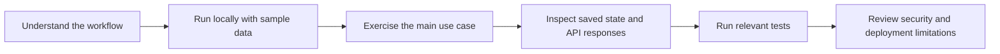
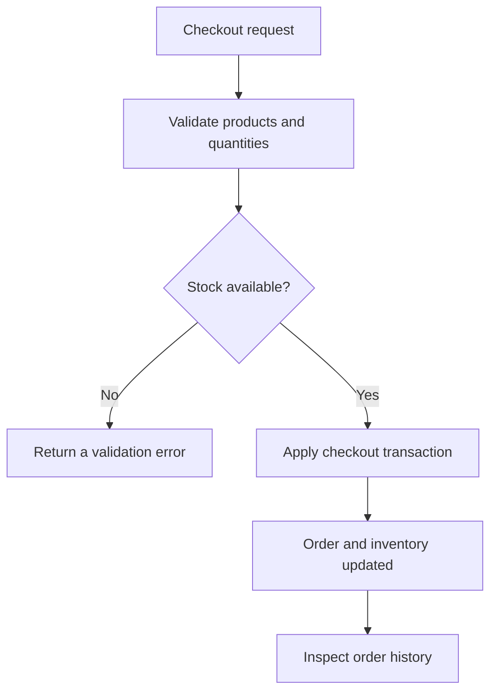
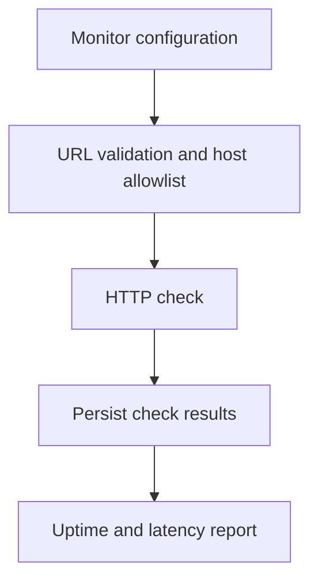
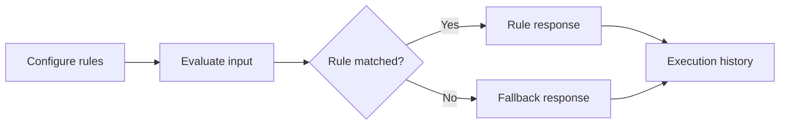

# DS9 | Engineering Atlas

> A guided technical index to the public Digital Solution9 software portfolio. Every link points to a public repository or a documented reviewer resource. This is a catalogue of local prototypes and case studies, not a claim of audited production systems.

[← Return to profile](https://github.com/shakaleita) · [Project directory](https://github.com/shakaleita?tab=repositories)

---

## 01 / Reading the work

A technical review should be reproducible. A useful path through each repository is:

Do not enter personal, payment, medical or other sensitive production data into local demos. No project is described here as independently security-certified or production-ready.

## 02 / Systems map

| Domain | Code repositories | Focus |
| :-- | :-- | :-- |
| **Business systems** | [TeamForge](https://github.com/shakaleita/teamforge-saas) · [Mercato](https://github.com/shakaleita/Mercato-E-Commerce-Platform) · [ClinicFlow](https://github.com/shakaleita/ClinicFlow-Medical-Booking-System) · [Pipeline](https://github.com/shakaleita/Pipeline-Sales-CRM) · [NexaCRM](https://github.com/shakaleita/nexacrm) · [BizFlow ERP](https://github.com/shakaleita/bizflow-erp) · [SupportDesk](https://github.com/shakaleita/supportdesk-saas) · [Laravel Inventory](https://github.com/shakaleita/laravel-inventory) · [RecruitFlow](https://github.com/shakaleita/recruitflow) · [InvoicePilot](https://github.com/shakaleita/invoicepilot) · [TeamTask](https://github.com/shakaleita/teamtask) · [ShopAdmin](https://github.com/shakaleita/shopadmin) | Operational state, inventory, tasks, scheduling and customer workflows |
| **Content & communication** | [KnowBase](https://github.com/shakaleita/KnowBase-Document-Search) · [CourseCraft](https://github.com/shakaleita/CourseCraft-Learning) · [PulseChat](https://github.com/shakaleita/PulseChat-Real-Time-Messaging) · [PageCraft](https://github.com/shakaleita/PageCraft-Headless-CMS) · [HelpBot](https://github.com/shakaleita/helpbot-widget) | Documents, learning, chat, content lifecycle and self-service |
| **Insights & automation** | [UptimePilot](https://github.com/shakaleita/UptimePilot-API-Monitoring) · [InsightLab](https://github.com/shakaleita/InsightLab-Business-Analytics) · [AgentHub API](https://github.com/shakaleita/agenthub-api) | Observability, analytics and deterministic rules |
| **Engineering archive** | [BeautyFort API](https://github.com/shakaleita/Beautyfort-API) | Legacy integration security review; third-party credits retained |

This classification matches the profile's charts. It describes primary use cases rather than exclusive technical boundaries.

## 03 / Design challenges & evidence

### Consistency under change — Mercato

The [Mercato](https://github.com/shakaleita/Mercato-E-Commerce-Platform) portfolio MVP documents transactional checkout, insufficient-stock protection, idempotent checkout, order cancellation and atomic stock restoration. The interesting engineering question is not simply whether an order can be created: it is whether orders and inventory stay consistent under retries and failures.

**Review lens:** boundaries between validation, durable state, business rules and error reporting. The repository README states the scope and security limitations.

### Scheduling without conflicts — ClinicFlow

[ClinicFlow](https://github.com/shakaleita/ClinicFlow-Medical-Booking-System) documents doctor availability, conflict-safe booking, rescheduling and event history.

**Review lens:** interval validation, conflict detection, change histories and safe demo-data handling. This is a scheduling prototype, not a live medical-data service.

### Traceable task activity — TeamForge

[TeamForge](https://github.com/shakaleita/teamforge-saas) documents workspace-specific activities, task comments, a Kanban-board API and an audit trail of changes.

**Review lens:** visibility of changes across a task's lifecycle, workspace scoping and persistence. The prototype uses single-owner access; it does not claim multi-tenant organisation permissions.

### Controlled monitoring — UptimePilot

[UptimePilot](https://github.com/shakaleita/UptimePilot-API-Monitoring) documents per-monitor reliability reports, latency information, host allowlisting and URL validation.

**Review lens:** validation and networking boundaries. Monitoring remote URLs is security-sensitive; the repository explicitly warns against unreviewed public deployment.

### Search and revision integrity — KnowBase & PageCraft

[KnowBase](https://github.com/shakaleita/KnowBase-Document-Search) documents document revision snapshots, FTS5 search and consistency testing across document updates and deletes.

[PageCraft](https://github.com/shakaleita/PageCraft-Headless-CMS) documents validated page slugs, draft/published status, revision comparison and rollback tests.

**Review lens:** how search indexes and published content stay aligned with edited source records.

### Explainable decisions — AgentHub API

[AgentHub API](https://github.com/shakaleita/agenthub-api) implements an ordered, deterministic keyword-rules engine with an execution audit.

**Review lens:** predictable results, auditability and simple validation. This is not an autonomous generative AI system.

## 04 / Follow the evidence

These three public repositories contain a full reviewer path: a runnable walkthrough, API interface and engineering decision record.

| Project | Start here | Read the interface | See the decisions |
| :-- | :-- | :-- | :-- |
| **AgentHub API** | [Demo](https://github.com/shakaleita/agenthub-api/blob/main/docs/DEMO.md) | [API](https://github.com/shakaleita/agenthub-api/blob/main/docs/API.md) | [Engineering](https://github.com/shakaleita/agenthub-api/blob/main/docs/ENGINEERING.md) |
| **BizFlow ERP** | [Demo](https://github.com/shakaleita/bizflow-erp/blob/main/docs/DEMO.md) | [API](https://github.com/shakaleita/bizflow-erp/blob/main/docs/API.md) | [Engineering](https://github.com/shakaleita/bizflow-erp/blob/main/docs/ENGINEERING.md) |
| **NexaCRM** | [Demo](https://github.com/shakaleita/nexacrm/blob/main/docs/DEMO.md) | [API](https://github.com/shakaleita/nexacrm/blob/main/docs/API.md) | [Engineering](https://github.com/shakaleita/nexacrm/blob/main/docs/ENGINEERING.md) |

### Reviewer questions worth asking

1. What business rule is protected by the database transaction or state change?
2. What happens when input is invalid, unavailable or repeated?
3. Does a read API reflect persisted records rather than a fixed demo response?
4. Can the workflow be reproduced with synthetic data and tested again?
5. What is deliberately missing before a public deployment would be appropriate?

## 05 / Operational boundaries

A prototype can be useful without being deployment-ready. The engineering docs make several common next steps explicit:

| Theme | Production-readiness questions |
| :-- | :-- |
| **Identity** | Are roles, ownership and cross-tenant access correctly enforced? |
| **Security** | Have threat modelling, secrets management, dependency review and network boundaries been assessed? |
| **Data** | Are migrations, backups, rollback and retention documented? |
| **Reliability** | Are monitoring, logs, failures, load tests and incident processes defined? |
| **Quality** | Do browser, accessibility, integration and regression tests cover critical journeys? |
| **Operations** | Is deployment isolated, repeatable and reviewed for its intended environment? |

These are **review questions**, not certifications or claims that a project has passed a production gate.

---

**Explore by topic:** [All public repositories](https://github.com/shakaleita?tab=repositories) · [Main DS9 profile](https://github.com/shakaleita)
